  <picture>
    <source media="(prefers-color-scheme: dark)" srcset="./assets/banner-dark.svg" />
    <source media="(prefers-color-scheme: light)" srcset="./assets/banner-light.svg" />
    
  </picture>

 

---

### ⚡ Projets & Travaux Récents

<table>
  <tr>
    <td width="50%" valign="top">
      <h4>📊 <a href="https://github.com/julesbataller/metabase">Metabase Analytics & BI Lab</a></h4>
      
Environnement d'analyse décisionnelle sous <b>Docker</b> & <b>PostgreSQL</b> : modélisation de données (Modèles, Métriques), requêtes SQL paramétrées (<i>Field Filters</i>) et automatisation via l'<b>API REST / JWT Embedding</b>.

      
<code>Metabase</code> <code>PostgreSQL</code> <code>Python</code> <code>Docker</code>

    </td>
    <td width="50%" valign="top">
      <h4>⚙️ <a href="https://github.com/julesbataller/doliproject">DoliProject — Automatisation ERP</a></h4>
      
Création et planification automatique des tâches liées au suivi du temps et aux factures récurrentes au sein de l'écosystème <b>Dolibarr ERP/CRM</b>.

      
<code>Dolibarr</code> <code>Automatisation</code> <code>Workflow</code>

    </td>
  </tr>
  <tr>
    <td width="50%" valign="top">
      <h4>📈 <a href="https://github.com/julesbataller/Plat4terfood_simulated">Plat4terfood Simulated</a></h4>
      
Simulation, traitement statistique et exploration de jeux de données alimentaires et logistiques développés sous <b>R</b>.

      
<code>R</code> <code>Data Analysis</code> <code>Simulation</code>

    </td>
    <td width="50%" valign="top">
      <h4>🧭 Focus Technique</h4>
      <ul>
        <li><b>Business Intelligence</b> : Dashboards interactifs & KPI métiers</li>
        <li><b>Ingénierie de données</b> : Requêtes SQL avancées & structuration</li>
        <li><b>Intégration</b> : Connecteurs API REST & automatisation Open Source</li>
      </ul>
    </td>
  </tr>
</table>

